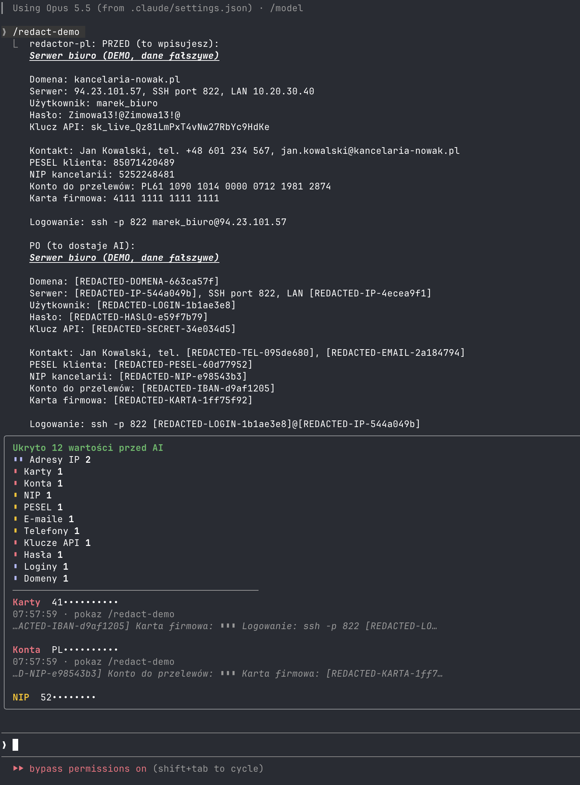

# Tarcza danych ("Data Shield")

A [Claude Code](https://claude.com/claude-code) and [OpenCode](https://opencode.ai) mod that **hides passwords and confidential data from the AI**. Before text reaches the model, the mod swaps each value for a placeholder (`[REDACTED-HASLO-1a2b3c4d]`). The model works on placeholders. When a command has to run on your machine, the mod puts the real value back.

It extends Ray Amjad's [`transcript-redactor`](https://github.com/ray-amjad/claude-code-mods) (MIT) with Polish data formats, a vault that learns from your notes, and a pane. Most labels and docs are in Polish, because it was built for a Polish training course.

> **A seat belt, not a vault.** See [SECURITY.md](SECURITY.md) for the known limits.

## What it looks like

`/redact-demo` prints a made-up server note before and after the swap, and the "Tarcza danych" pane counts what was hidden. All data in the screenshots is made up.



## Install

```
claude plugin marketplace add hubsoapp-beep/tarcza-danych
claude plugin install redactor-pl@tarcza-danych --scope user
```

Restart Claude Code and run `/redact-demo`.

### OpenCode

The same shield runs in [OpenCode](https://opencode.ai) 2.0.32+. The redaction engine and the Polish layer are shared; the hooks differ and there is no pane (use `/redactions` for counts).

```sh
git clone https://github.com/hubsoapp-beep/tarcza-danych.git
cd tarcza-danych
./scripts/install-opencode.sh
```

The script adds the plugin to `~/.config/opencode/opencode.json`. Details and limits: [plugins/redactor-opencode/README.md](plugins/redactor-opencode/README.md).

### Other agents

- **Grok Build** — MVP: local proxy + `PreToolUse`/`PostToolUse` hooks:
  [adapters/grok/README.md](adapters/grok/README.md).
- **Gemini CLI / Qwen Code** — next, the fullest hook set.
- **Codex CLI / Cline / Aider / Continue** — generic proxy, redaction only.

Capability matrix: [docs/AGENCI.md](docs/AGENCI.md). Order: [ROADMAP.md](ROADMAP.md).

## What it hides

Vendor keys and tokens (about 70 formats), passwords after Polish or English labels (including low-entropy ones), Polish personal data with checksums (PESEL, NIP, REGON, ID card, IBAN, card, phone), IP addresses, logins, domains, emails, a glossary of your own clients and people, and every password, login and domain found in notes you point it at.

## How it works

Text passes three layers: prompt → session context → model request. Every value gets a stable placeholder. Before a local tool runs, the placeholder is swapped back; the tool output is scanned again. The `context` layer scans every request, so text from an unknown source is still checked on the way out.

Flow, file map, detectors and the Claude Code vs OpenCode differences: [docs/JAK-DZIALA.md](docs/JAK-DZIALA.md).

## Roadmap

Next tasks, split into agents with acceptance criteria: [ROADMAP.md](ROADMAP.md).

## License

MIT, © 2026 Miłosz Zając. Contains code from `transcript-redactor` (MIT, © 2026 Ray Amjad). See [NOTICE.md](NOTICE.md).
