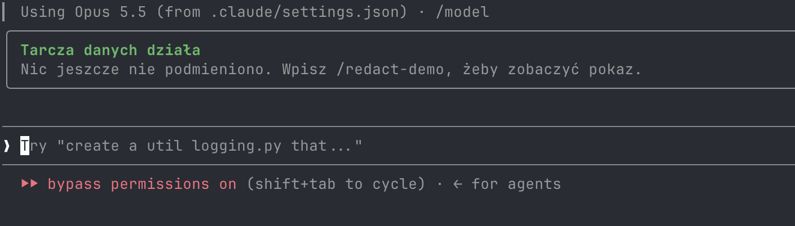

# Tarcza danych

[](https://github.com/hubsoapp-beep/tarcza-danych/actions/workflows/ci.yml)
[](LICENSE)

Mod do [Claude Code](https://claude.com/claude-code), który **ukrywa hasła i dane poufne przed AI**. Zanim tekst trafi do modelu, mod podmienia wartość na placeholder (`[REDACTED-HASLO-1a2b3c4d]`). Model pracuje na placeholderach. Gdy komenda ma się wykonać na Twoim komputerze, mod wraca do prawdziwej wartości.

*English: see [README.en.md](README.en.md).*

Powstał na szkolenie z AI i jest rozwinięciem [`transcript-redactor`](https://github.com/ray-amjad/claude-code-mods) Raya Amjada (MIT) o polskie dane, sejf z notatek i panel.

> **To pas bezpieczeństwa, nie sejf.** Zmniejsza ryzyko pomyłki. Nie zastępuje nawyków: nie wklejaj haseł, nie używaj jednego hasła w wielu miejscach. Lista granic jest w [SECURITY.md](SECURITY.md).

## Jak to wygląda

`/redact-demo` pokazuje fałszywą notatkę serwera przed i po podmianie, a panel „Tarcza danych” liczy, co zostało ukryte (kategorie, maski wartości, źródło). Wszystkie dane na zrzutach są zmyślone.


Panel zaraz po starcie sesji, zanim cokolwiek zostanie ukryte:



## Co ukrywa

- **Klucze i tokeny** (około 70 formatów, JWT, klucze prywatne): silnik upstream.
- **Hasła po polsku i angielsku**: `Hasło:`, `**Password:**`, komórki tabel, backticki, także niskiej entropii („ludzkie”).
- **Dane osobowe PL z sumą kontrolną**: PESEL, NIP, REGON, dowód, IBAN, karta, telefon +48. Losowe numery zostają nietknięte.
- **Infrastruktura**: adresy IP (także lokalne), loginy, domeny, e-maile.
- **Sejf z notatek**: przy starcie sesji mod czyta wskazany folder i ukrywa każde hasło, login i domenę stamtąd wszędzie, także gdy wpiszesz je z pamięci, bez etykiety.
- **Słownik własny**: `KLIENT: Kancelaria Nowak`, `OSOBA: Jan* Kowalsk*` (gwiazdka łapie polskie końcówki).
- **Panel „Tarcza danych”** z licznikami na kategorię i maskami wartości, tryb projektora na czas pokazu.

Pełny opis, ustawienia i różnice względem upstream: [plugins/redactor-pl/README.md](plugins/redactor-pl/README.md).

## Instalacja (na każdym komputerze)

Potrzebujesz Claude Code. Dwie komendy:

```
claude plugin marketplace add hubsoapp-beep/tarcza-danych
claude plugin install redactor-pl@tarcza-danych --scope user
```

Albo jednym skryptem:

```
curl -fsSL https://raw.githubusercontent.com/hubsoapp-beep/tarcza-danych/main/scripts/install.sh | sh
```

Zrestartuj Claude Code i wpisz `/redact-demo`. Aktualizacja: `claude plugin marketplace update tarcza-danych`.

> Jeśli używasz `transcript-redactor` albo `redaction-pane`, wyłącz je. Ta wersja zawiera oba i dwa redaktory naraz mogłyby się pokłócić.

## Komendy

| Komenda | Co robi |
| --- | --- |
| `/redact-demo` | Fałszywa notatka serwera przed i po podmianie. Do pokazu. |
| `/redact-test <tekst>` | Sprawdza, co zobaczy AI, bez wysyłania. |
| `/redactions` | Otwiera panel. `projector on` / `projector off` chowa i pokazuje maski. |

## Dane prywatne zostają u Ciebie

W repozytorium nie ma żadnych prawdziwych danych. Twoje notatki (sejf) i słownik czyta mod lokalnie, z miejsc, które sam wskażesz: `/plugin configure redactor-pl@tarcza-danych`. Słownik trzymaj w `~/.claude/redactor-pl/slownik.txt`, poza repozytorium. Wzór: [plugins/redactor-pl/slownik.example.txt](plugins/redactor-pl/slownik.example.txt). Wartości z notatek żyją tylko w pamięci procesu i nie trafiają na dysk ani do logów.

## Rozwój

Zasady i uruchamianie testów: [CONTRIBUTING.md](CONTRIBUTING.md). Zmiany: [CHANGELOG.md](CHANGELOG.md).

## Licencja

MIT, © 2026 Miłosz Zając. Część kodu pochodzi z `transcript-redactor` (MIT, © 2026 Ray Amjad), patrz [NOTICE.md](NOTICE.md).
